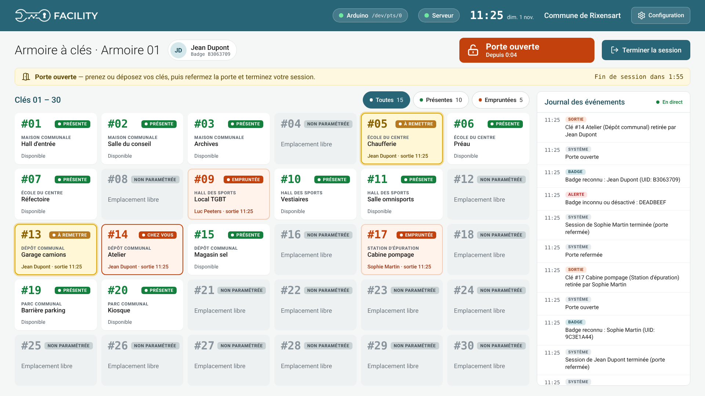
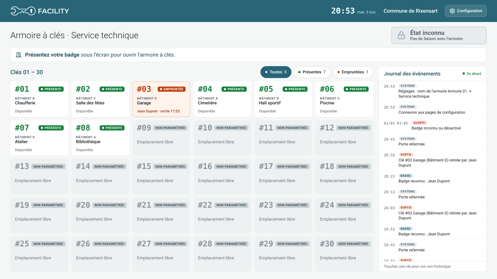
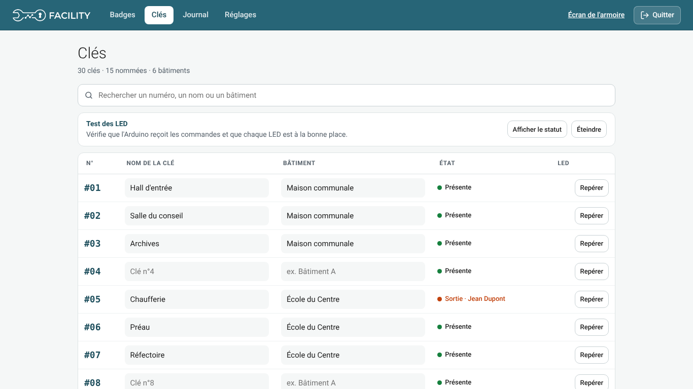
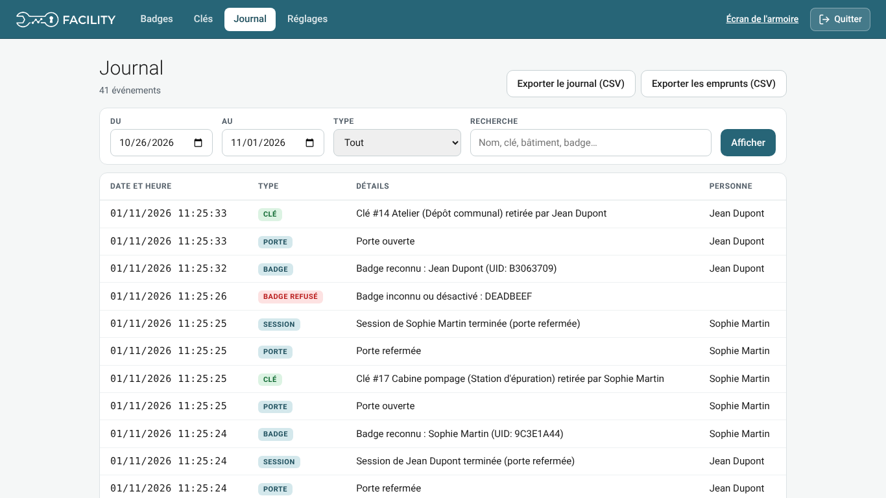
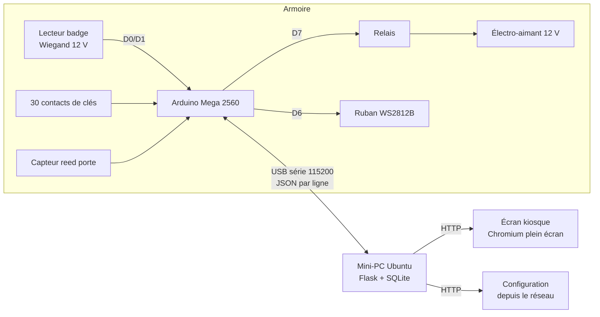

# Armoire à clés connectée — Commune de Rixensart

Armoire à clés à badge pour le service technique : chaque agent badge, la porte s'ouvre, les clés qu'il prend
sont enregistrées à son nom, et un écran affiche en permanence quelles clés sont présentes, sorties et chez qui.



## Fonctionnalités

- **Accès par badge** RFID (lecteur Wiegand 125 kHz + 13,56 MHz), liste des personnes autorisées gérée à l'écran.
- **Électro-aimant** commandé par relais, durée d'ouverture réglable.
- **30 emplacements de clés** surveillés (contacts sur l'Arduino) : chaque clé retirée est attribuée à la personne qui a badgé.
- **LED par clé** (ruban WS2812B) allumées à l'ouverture de la porte :
  vert = présente, rouge = sortie, jaune clignotant = clé que la personne doit remettre.
- **Capteur de porte** (reed) : alerte visuelle et sonore si la porte reste ouverte, fin de session à la fermeture.
- **Écran kiosque tactile** (thème FACILITY) : grille des clés visible par tous, journal défilant, historique
  de chaque clé au toucher, état de la porte, sans clignotement ; horizontal ou vertical ; veille automatique
  (rallumage au toucher ou au badge).
- **Configuration protégée** par code maître ou par le badge des personnes autorisées : badges (scan, saisie,
  import CSV/Excel), nom et bâtiment des clés, journal filtrable et exportable en CSV, nom de l'armoire,
  temporisations, orientation, veille, état du système (Arduino, horloge, test du son), clavier tactile.
- **Support de LED imprimé en 3D** (`mecanique/`) : presse-étoupe pour pixels WS2811 de 12 mm.

| Veille | Configuration des clés | Journal |
|---|---|---|
|  |  |  |

## Architecture



- **Arduino** (`firmware/armoire_cles`) : lit les capteurs, envoie des événements JSON, exécute les commandes
  (LED, relais). Il ne prend aucune décision : tout est décidé par le serveur.
- **Serveur Flask** (`serveur/`) : sessions, emprunts, base SQLite, API, pages web. Service systemd `keybox`.
- **Écran** : page web servie par Flask, affichée par Chromium en mode kiosque au démarrage du mini-PC.

## Démarrage rapide

```bash
git clone <ce dépôt> smart_key_box && cd smart_key_box/serveur
python3 -m venv venv && venv/bin/pip install -r requirements.txt
KEYBOX_SERIAL_PORT=/dev/ttyUSB0 venv/bin/python app.py      # http://127.0.0.1:5000/
```

Installation complète (service, kiosque, Arduino) : **[docs/installation.md](docs/installation.md)**.

## Documentation

| Document | Contenu |
|---|---|
| [Installation](docs/installation.md) | Serveur, service systemd, écran kiosque, téléversement Arduino |
| [Câblage](docs/cablage.md) | Schéma électrique, affectation des broches, alimentations |
| [Utilisation](docs/utilisation.md) | Emprunter / rendre une clé, pages de configuration |
| [Protocole série](docs/protocole-serie.md) | Messages JSON entre l'Arduino et le serveur |
| [API](docs/api.md) | Routes HTTP du serveur |
| [Dépannage](docs/depannage.md) | Problèmes rencontrés et solutions |

## Arborescence

```
serveur/            backend Flask (app.py, armoire.py, badges_admin.py, serial_worker.py, screen.py, models.py)
  static/kiosk/     écran de l'armoire (HTML/CSS/JS, polices, logo)
  static/admin/     pages de configuration (badges, clés, journal, réglages, clavier tactile)
firmware/
  armoire_cles/     sketch de l'Arduino Mega
  test_wiegand/     sketch de test du lecteur de badge
deploiement/        service systemd, kiosque Chromium, connexion automatique
docs/               documentation, captures d'écran, schéma de câblage (PDF/SVG)
mecanique/          pièces imprimées en 3D (presse-étoupe des LED, OpenSCAD + STL)
```

## Sécurité et données

- Le code admin est fourni par la variable d'environnement `KEYBOX_ADMIN_PASSWORD` (jamais dans le code).
- La base `instance/keybox.db` (noms, badges, journal) n'est **pas** versionnée (`.gitignore`).
- Le relais est câblé sur le contact **NC** : si l'Arduino ou le mini-PC s'arrête, la porte reste verrouillée.

## Licence

[MIT](LICENSE) — © 2026 Tomacbe.
