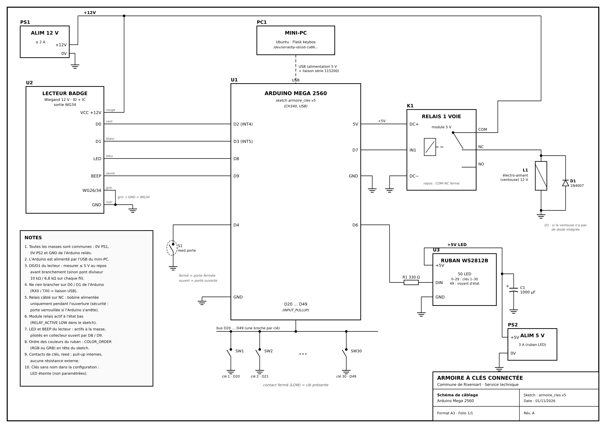

# Câblage

Schéma complet (A3) : **[PDF](schema/schema_cablage_armoire.pdf)** · [SVG modifiable](schema/schema_cablage_armoire.svg)
(régénérable avec `python3 schema/generer_schema.py`).



## Affectation des broches (Arduino Mega 2560)

| Broche | Élément | Remarque |
|---|---|---|
| **D2** (INT4) | Lecteur badge — D0 (fil vert) | interruption |
| **D3** (INT5) | Lecteur badge — D1 (fil blanc) | interruption |
| **D4** | Capteur reed de porte | autre fil à GND, pull-up interne |
| **D6** | Ruban WS2812B — DIN | via résistance 330 Ω |
| **D7** | Module relais — IN1 | actif à l'état bas |
| **D8** | Lecteur badge — LED (fil bleu) | actif à la masse (collecteur ouvert) |
| **D9** | Lecteur badge — BEEP (fil jaune) | actif à la masse (collecteur ouvert) |
| **D20 … D49** | Contacts des clés 1 … 30 | autre fil à GND, LOW = clé présente |
| **5V / GND** | Module relais DC+ / DC− | |
| USB | Mini-PC | alimentation de l'Arduino + liaison série |
| ~~D0 / D1~~ | **à laisser libres** | RX0 / TX0 = liaison USB |

## Lecteur de badge (Wiegand 12 V, ID + IC)

| Fil | Fonction | Raccordement |
|---|---|---|
| Rouge | +12 V | + alimentation 12 V |
| Noir | GND | − alimentation 12 V **et** GND Arduino |
| Vert | D0 | D2 |
| Blanc | D1 | D3 |
| Bleu | LED | D8 (facultatif) |
| Jaune | BEEP | D9 (facultatif) |
| Gris | Choix WG26 / WG34 | GND = WG34 sur le modèle utilisé (vérifier : 34 bits attendus) |
| Violets | Sonnette | non utilisés |

Les noms D0/D1 du lecteur désignent les lignes Wiegand, **pas** les broches 0/1 de l'Arduino.
Mesurer au repos ≤ 5 V sur les fils vert et blanc avant de les brancher (sinon pont diviseur 10 kΩ / 6,8 kΩ).

## Relais et électro-aimant

```
+12 V ──► COM (relais)
NC    ──► + électro-aimant
0 V   ──► − électro-aimant          (diode 1N4007 en roue libre si la ventouse n'en a pas)
```

Au repos le contact COM–NC est fermé : l'aimant est alimenté, la porte est verrouillée. La bobine du relais
n'est alimentée que pendant l'ouverture (et coupée dès que le capteur voit la porte s'ouvrir).
En cas de panne de l'Arduino ou du mini-PC, la porte reste verrouillée.

## Ruban LED

- WS2812B, 50 LED : LED 0-29 = clés 1-30, LED 49 = voyant d'état (vert : ouverture, rouge : badge refusé).
- Alimentation 5 V séparée (3 A pour 50 LED), masse commune avec l'Arduino.
- Résistance 330 Ω en série sur DIN, condensateur 1000 µF entre +5 V et GND près du ruban.

## Masses

Toutes les masses sont reliées : 0 V de l'alimentation 12 V, 0 V de l'alimentation 5 V, GND de l'Arduino.
Sans masse commune, l'Arduino ne lit pas le lecteur de badge.
