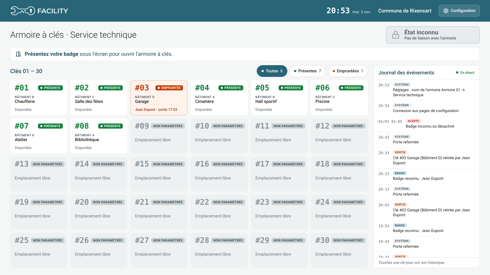
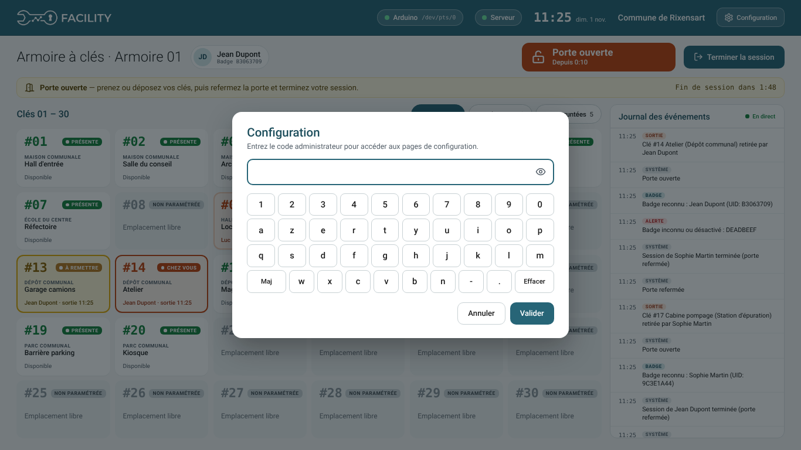
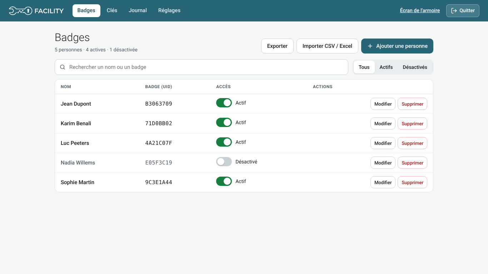
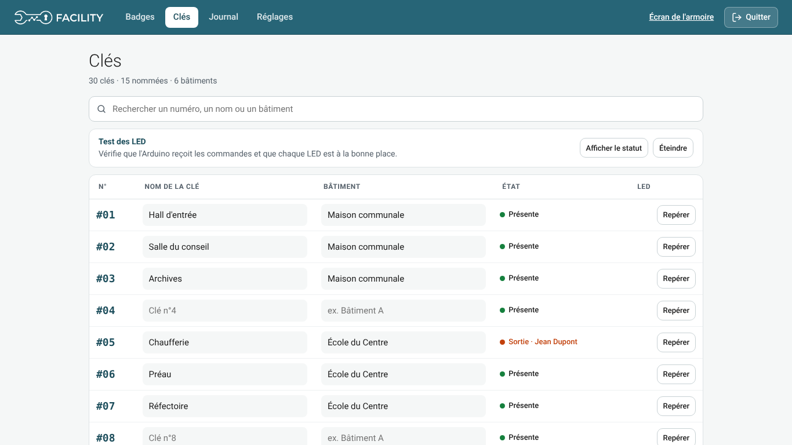
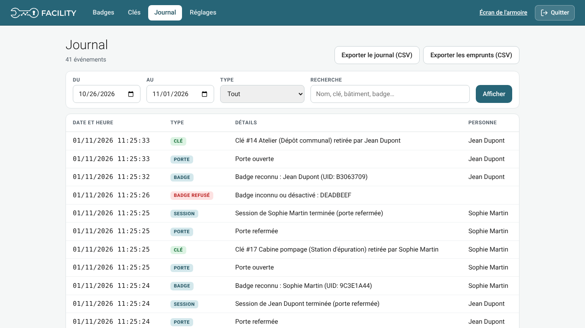
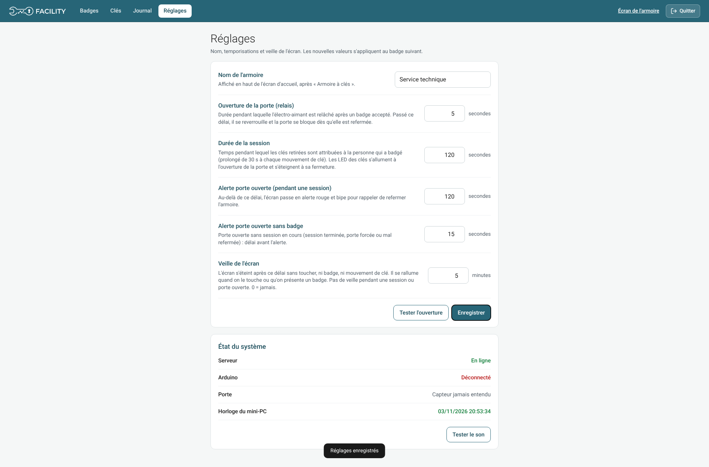

# Utilisation

## Prendre ou rendre une clé

1. **Présenter son badge** sous l'écran. Le lecteur passe au vert et bipe ; l'écran affiche « Bonjour … ».
   Badge inconnu ou désactivé : 3 bips, voyant rouge, message à l'écran.
2. **Ouvrir la porte** pendant le délai d'ouverture. Les LED s'allument :
   - **vert** : clé présente,
   - **rouge** : clé sortie,
   - **jaune clignotant** : clé que vous aviez prise lors d'un passage précédent — à remettre.
3. **Prendre ou déposer** une ou plusieurs clés. Chaque clé prise est enregistrée à votre nom, chaque clé
   remise est clôturée ; l'écran se met à jour aussitôt.
4. **Refermer la porte** : la session se termine, les LED s'éteignent. (Bouton « Terminer la session » si besoin.)

Si la porte reste ouverte trop longtemps, l'écran passe en alerte rouge avec un bip (« Couper le son 2 min »
coupe le bip, pas l'alerte). L'écran ne clignote jamais : alerte en rouge fixe, clés à remettre en jaune fixe.

**Deux personnes, porte ouverte** : si quelqu'un arrive pendant que la porte est encore ouverte, il doit
badger aussi. Les clés qu'il prend après son badge sont à son nom ; celles qu'il a prises dans les 30 s
précédant son badge (réglable) lui sont réattribuées, et le journal l'indique. La session de la personne
précédente se termine à ce moment.

**Historique d'une clé** : toucher sa carte dans la grille (qui l'a sortie, quand, quand elle est revenue).
Le journal à droite défile au doigt ; « Haut de la liste » ramène aux derniers événements.

**Veille** : l'écran s'éteint après 5 minutes sans activité (réglable) et se rallume dès qu'on le touche ou
qu'on présente un badge. Le toucher qui rallume l'écran ne déclenche rien d'autre.

## Configuration

Bouton **Configuration** en haut à droite de l'écran (ou `http://<ip>:5000/` depuis un PC du réseau), puis
**code maître**, ou **badge** pour les personnes autorisées (colonne « Configuration » de la page Badges) :
- sur la borne, toucher « Configuration » puis passer son badge (la porte ne s'ouvre pas) ;
- ou repasser son badge pendant sa propre session.
Les modifications faites après une connexion par badge sont journalisées au nom de la personne. Sur l'écran tactile, un clavier s'affiche automatiquement. Retour à l'écran d'accueil
automatique après 5 minutes sans action sur la borne.

### Badges

Liste des personnes, recherche, accès actif / désactivé, modification, suppression.
- **Ajouter une personne** : saisir le nom, puis « Scanner le badge » et le passer sur le lecteur (ou taper l'UID
  hexadécimal).
- **Importer CSV / Excel** : colonnes `nom`, `uid`, `actif` (oui/non) — aperçu avant validation, un badge déjà
  connu est mis à jour, jamais dupliqué. Modèle téléchargeable.

### Clés

Nom et bâtiment de chaque emplacement (enregistrés en quittant la case). Une clé **sans nom** est
**non paramétrée** : grise à l'écran, LED éteinte, pas d'emprunt ni d'alerte.
**Test des LED** : afficher le statut sur le ruban, « Repérer » une clé (sa LED clignote en jaune).

### Journal

Filtres par dates, type (clés, badges, porte, alertes, configuration) et texte. Exports CSV du journal et des
emprunts (clé, nom, bâtiment, emprunteur, sortie, retour, durée), à faire de préférence depuis un PC du réseau.

### Réglages

Nom de l'armoire (affiché sur l'écran d'accueil), orientation de l'écran (horizontal / vertical, l'image et le
toucher tournent ensemble), durée d'ouverture du relais, durée de session, délai d'alerte
porte ouverte (pendant une session / sans badge), veille de l'écran, bouton « Tester l'ouverture ».
**État du système** : liaison Arduino, porte, horloge du mini-PC (avertit si elle semble fausse), « Tester le son ».

