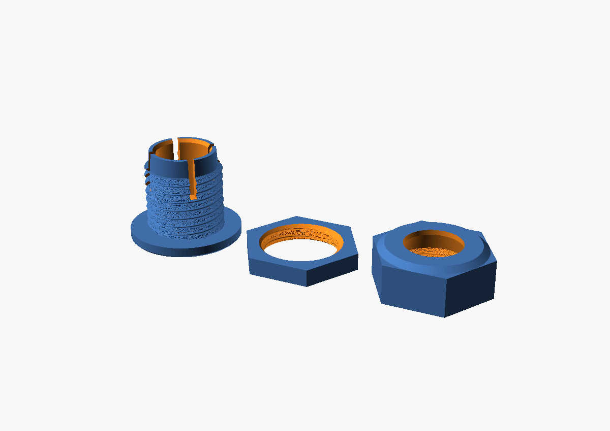

# Pièces mécaniques (impression 3D)

## Presse-étoupe pour pixel LED WS2811 de 12 mm — `presse_etoupe_pixel12.scad`

Tient chaque pixel de la chaîne dans un panneau bois / MDF de 3 à 6 mm, dôme visible à l'avant.

| Pièce | Fichier |
|---|---|
| Corps : collerette avant, tige filetée 18 × 2, pince à 4 lamelles | `presse_etoupe_corps.stl` |
| Contre-écrou (serre le corps contre le panneau) | `presse_etoupe_contre_ecrou.stl` |
| Écrou-chapeau (son cône intérieur resserre la pince sur le pixel) | `presse_etoupe_ecrou_chapeau.stl` |

**Montage** : percer à 18 mm ; enfiler l'écrou-chapeau puis le contre-écrou sur le pixel par le dôme ; passer le
corps dans le trou par l'avant ; pousser le pixel par l'arrière jusqu'à la butée ; visser le contre-écrou puis
l'écrou-chapeau.

**Impression** : PETG ou PLA, corps collerette sur le plateau, écrous à plat, sans support, couche 0,2 mm.
Imprimer un jeu d'essai et ajuster dans OpenSCAD (Customizer) : `pixel_d` (diamètre mesuré du pixel),
`fenetre_d` / `butee`, `serrage`, `jeu_filet`, `panneau_max`.
